# ninfer-ext

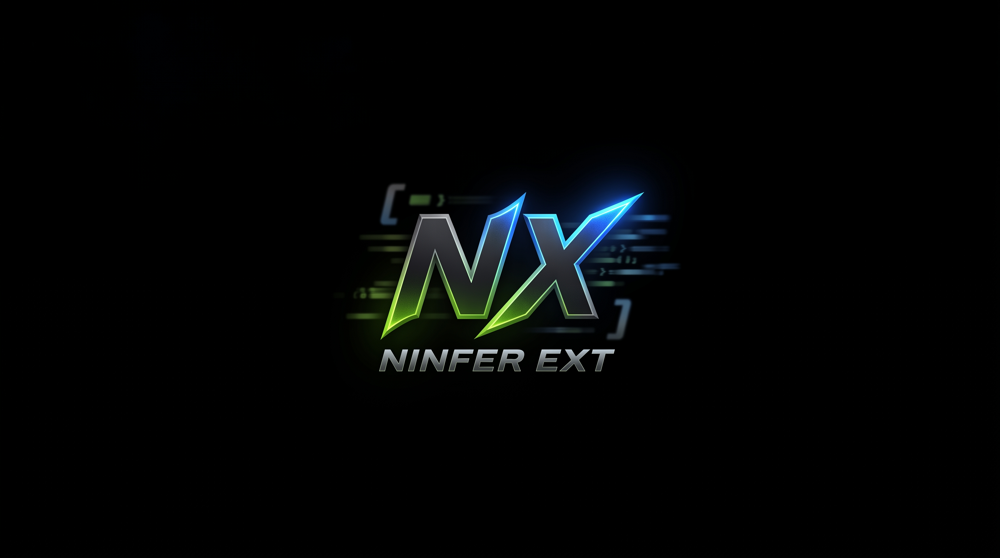

ninfer-ext is an extended fork of [Neroued/ninfer](https://github.com/Neroued/ninfer), a from-scratch
C++/CUDA inference engine for maximum single-GPU performance on one NVIDIA GeForce RTX 5090.

It adds [Qwen3.8-Flash-Next](docs/flash-next.md) (a ~180B MoE that stock NInfer cannot load at all),
[speculative decoding](docs/speculative-decoding.md) beyond the upstream default,
[EXL3 quantization](docs/quantization.md), constrained decoding and tool calls, deeper serving work
for long-running agents, and [Gemma 4](docs/gemma4.md) text and vision through the same Engine.

It is **not** faster than stock everywhere: [versus stock NInfer](docs/vs-stock-ninfer.md) reports both
sides, including the two cases where stock is ahead.

## Benchmarks

Measured on one RTX 5090; the [test system](#test-system) and [conditions](#benchmark-conditions) are
below. Every model runs through the same `ninfer-serve`, CLI and Engine.

The numbers come from different builds, and each section says which: the master charts, the MTP
comparison and the Qwen3.6-27B quotes are from the current tree, while the serving and single-request
tables are from fork commits `19f38b77` and `f8106aa9` (same Engine; only benchmark sizing changed) and
the Flash-Next rows from `fc305acd` and `7fbabfbc` (CUDA 13.3 and 13.4). Two later commits — a
tensor-core A16 kernel for NVFP4 MLP projections and the adaptive-MTP batch draft length — are not
reflected in those two tables; [versus stock](docs/vs-stock-ninfer.md) carries the same caveat.

### Master charts

One figure per model, drawn by [`tools/bench/plot_master.py`](tools/bench/plot_master.py) from the runs
in `profiles/bench/all_models/`. Each has four panels: prefill and decode against context (a line per
concurrency) and the same two against concurrency (a line per context). Six models have one;
Qwen3.6-27B is quoted under [serving throughput](#serving-throughput) instead, because its campaign
was run separately and is not in that root. The decode panels carry the same-session MTP run as a
dashed line labelled with its mode, so plain and speculative decode sit in one chart.

Prefill is the per-request rate at c1 and the point aggregate at c2–c8 (prompt tokens over the whole
makespan, so it includes each request's decode); decode is the steady rate over complete intervals
whose decode batch equals the concurrency. Panels are sparse on purpose, because a concurrency can only
reach the contexts its KV window fits — 262,144 tokens at one lane, 32,768 at eight on this card.

**Gemma 4 26B-A4B QAT** — decode at one lane 330.5 → 320.0 → 291.0 → **212.5** tok/s across 300 / 8k /
31k / 123k tokens of context, 674.9 at eight lanes; mean NLL 5.039971 (PPL 154.466) over
`ninfer-ppl-1m-v1` full.

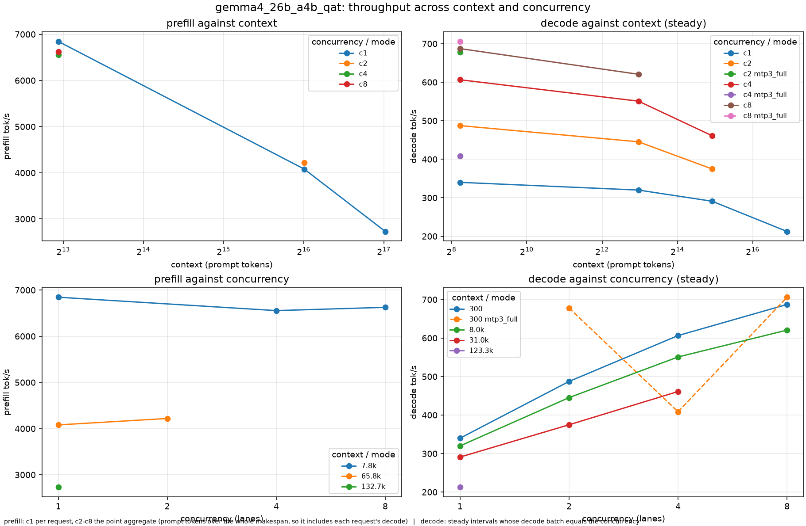

**Gemma 4 31B IT M1** — decode 53–155 tok/s.

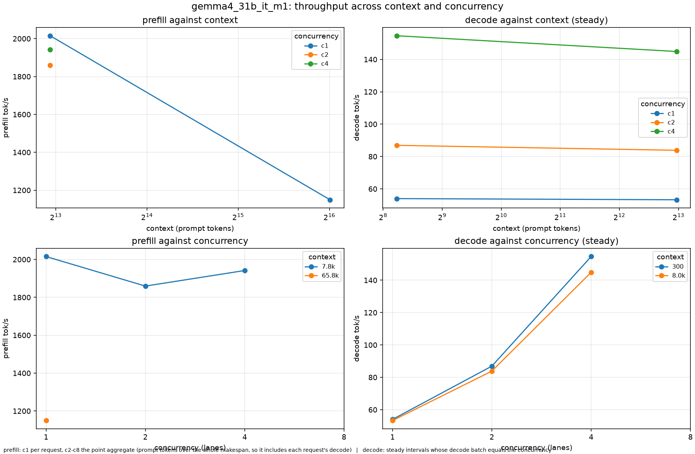

**Qwen3.6-35B-A3B** — prefill 5,310–16,723 tok/s, decode 257–1,376.

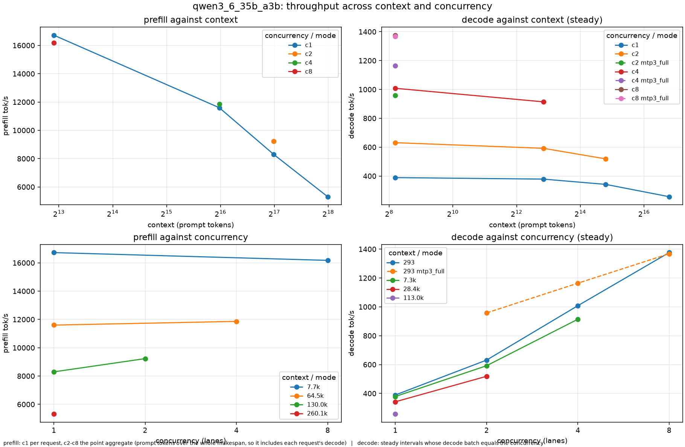

**Qwen3.6-35B-A3B `nvfp4`** — prefill 5,838–23,343 tok/s, decode 253–1,338.

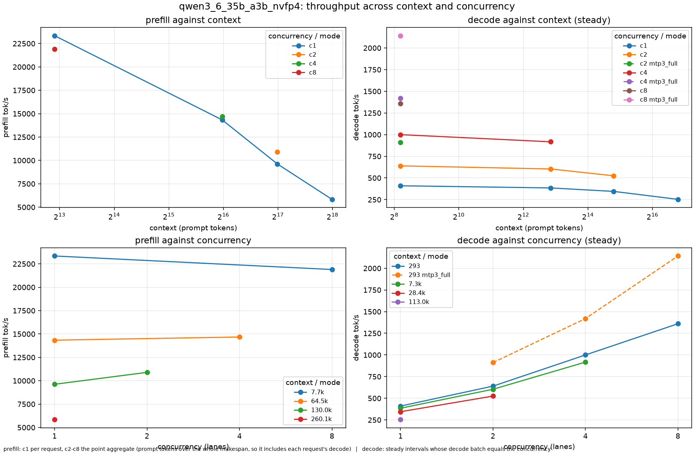

**Qwen3.8-27B `groupwise-int`** — prefill 2,255–3,264 tok/s, decode 80–422.

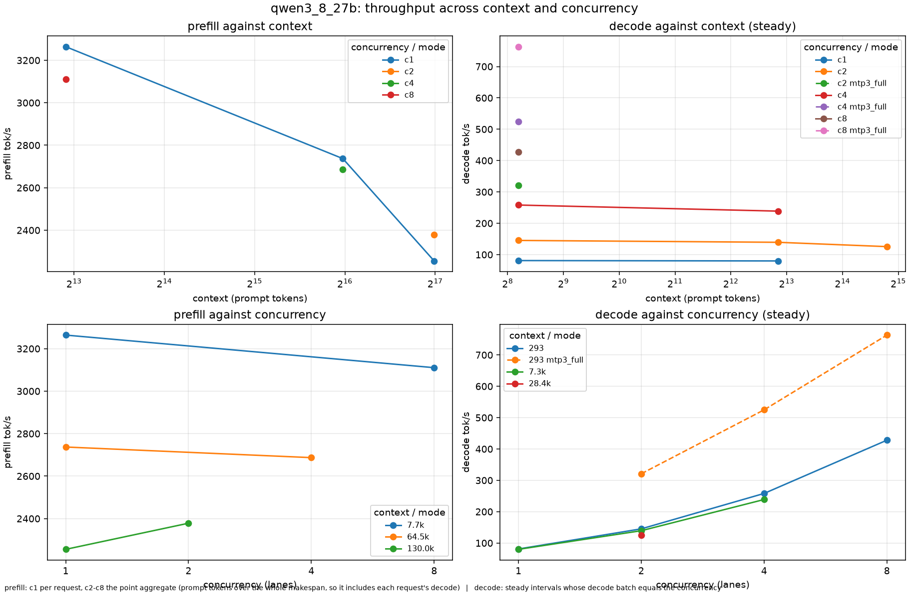

**Qwen3.8-27B `nvfp4`** — prefill 4,034–9,795 tok/s, decode 76–545.

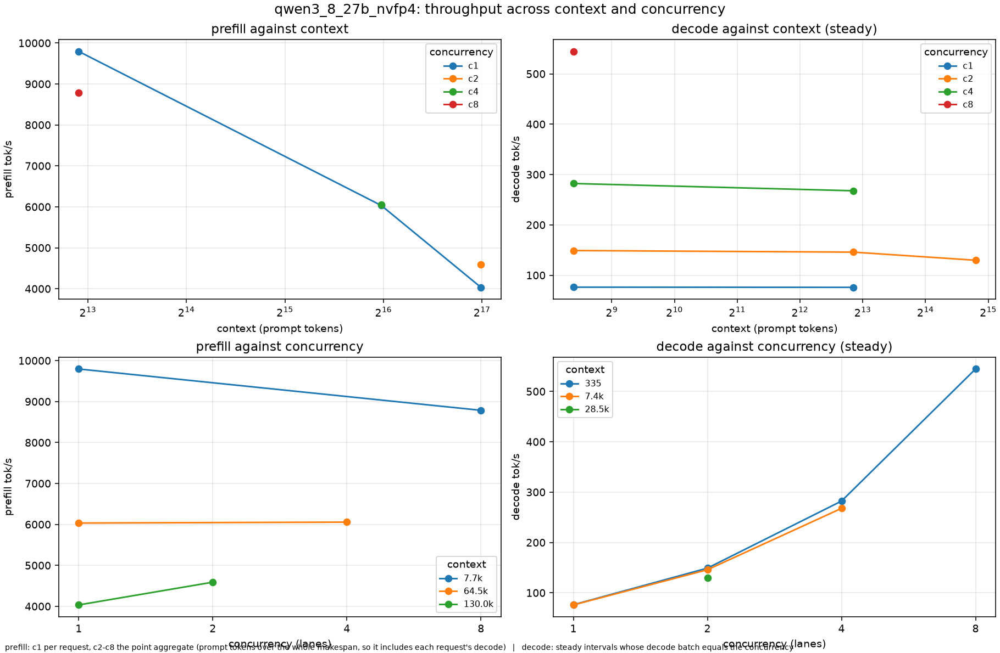

<details>
<summary>MTP against plain decode, same session, both modes in one invocation</summary>

The runs the dashed lines in the decode panels come from, in detail: decode at a ~300-token context,
gain at two / four / eight lanes. Speculation pays where decode is
weight-bound and stops paying once the engine already has a full batch: the dense 27B models gain
about 2x at every concurrency, while on Gemma 4 26B-A4B at four lanes MTP is *slower* than plain
decode (606 → 409 tok/s) because the draft passes cost more than the tokens they commit.

| Model | c2 | c4 | c8 | acceptance |
|---|---|---|---|---|
| Gemma 4 26B-A4B QAT | 1.39x | **0.67x** | 1.03x | 0.82–0.85 |
| Qwen3.6-35B-A3B | 1.46x | 1.12x | 0.98x | 0.72–0.75 |
| Qwen3.6-35B-A3B `nvfp4` | 1.43x | 1.42x | 1.57x | 0.71–0.74 |
| Qwen3.8-27B `groupwise-int` | 2.21x | 2.03x | 1.78x | 0.81–0.82 |
| Qwen3.8-27B `nvfp4` | 2.10x | 1.98x | 1.87x | 0.59–0.63 |

Gemma 4 runs MTP on the full proposal head only (1–7 draft tokens) and refuses the optimized one, so
`--lm-head-draft` must not be passed for it.

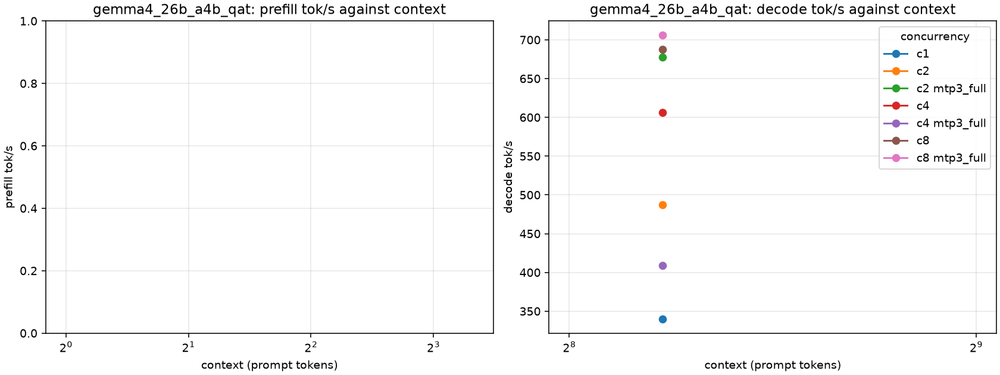

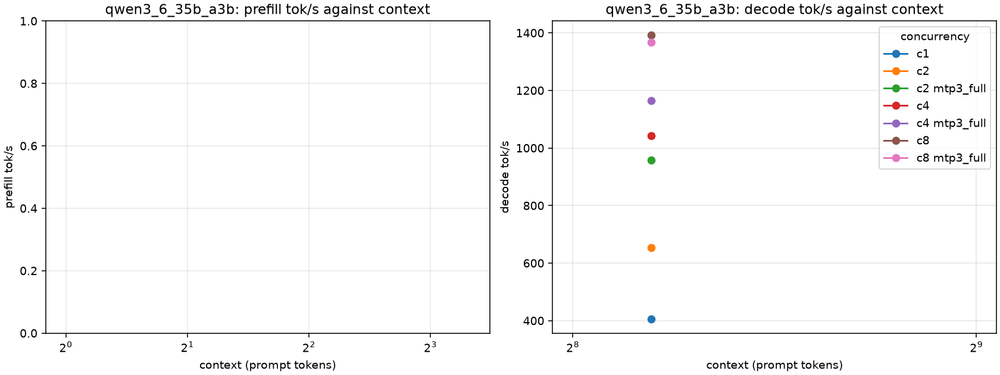

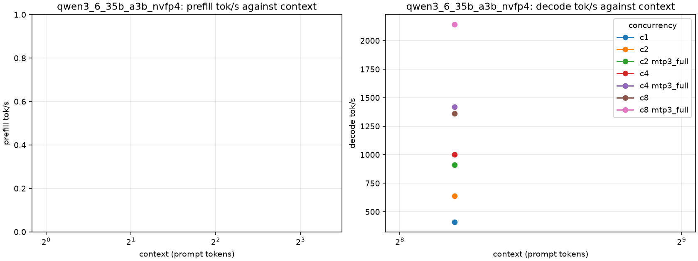

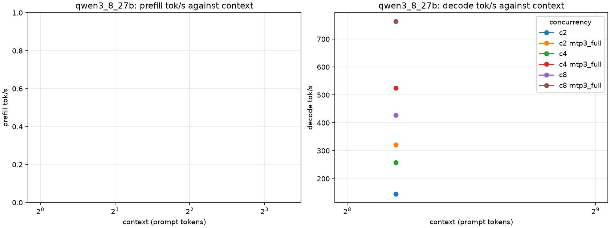

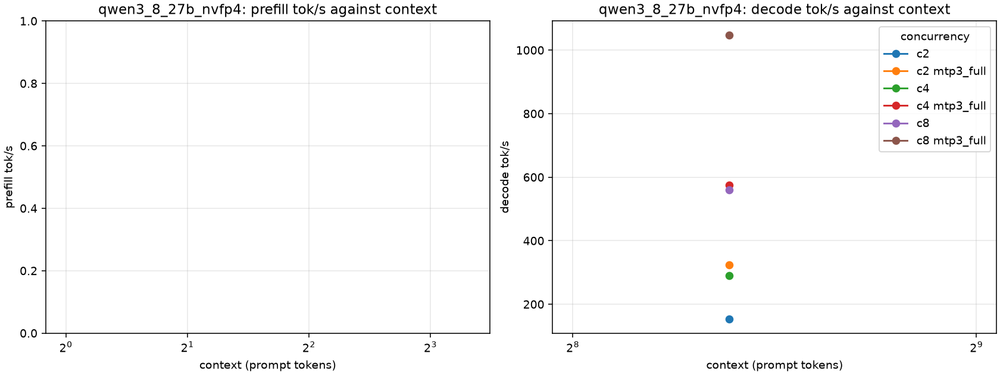

</details>

### Serving throughput

Aggregate decode tok/s from `ninfer-serve`, with C concurrent requests each writing a 512-token
essay (mean of two runs). Bold marks the faster mode at each concurrency.

| Artifact | Mode | C=1 | C=2 | C=4 | C=8 |
|---|---|---:|---:|---:|---:|
| Qwen3.8-27B `nvfp4` | plain | 78.6 | 149.0 | 254.3 | 492.3 |
| | `--spec mtp` | **127.2** | **253.1** | **423.0** | **730.4** |
| Qwen3.8-27B `groupwise-int` | plain | 81.8 | 146.0 | 260.1 | 415.9 |
| | `--spec mtp` | **127.7** | **219.3** | **340.3** | **453.2** |
| Qwen3.6-35B-A3B `groupwise-int` | plain | 386.6 | 619.8 | **972.3** | **1,324.4** |
| | `--spec mtp` | **491.9** | **663.5** | 850.9 | 1,001.0 |
| | `--spec dflash --draft-tokens 7` | 355.4 | 452.1 | 507.7 | 898.9 |
| Qwen3.8-Flash-Next `nvfp4` | plain | **98.5** | **141.6** | **180.6** | **185.3** |
| | `--spec mtp` | 82.2 | 136.8 | 165.0 | 182.1 |

On this prose load, 35B-A3B speculation loses from C=4 up. On the long-reasoning load it wins instead:
MTP K=3 beats plain at C=4 and DFlash7 is fastest at C=8. Which mode wins depends on the workload —
[recommended settings](docs/speculative-decoding.md#recommended-settings) has the per-model answer, and
[versus stock](docs/vs-stock-ninfer.md) the same load measured against upstream.

Qwen3.6-27B was measured in its own campaign rather than this one — a 293-token prompt, an
8,192-token generation per request, INT8 group-64 KV and MTP=3 — so its numbers are quoted, not
tabulated above: **185.8 / 247.0 / 309.5 / 535.0** tok/s aggregate decode at C=1/2/4/8, with MTP=3 and
73–79% acceptance on long reasoning. With MTP off it decodes 77.6 / 70.7 / 64.5 / 54.8 tok/s at
7.7k / 64.5k / 130k / 260k tokens of context, at 3,218 / 2,656 / 2,185 / 1,615 tok/s prefill. The
[`groupwise-int` card](model-cards/Qwen3.6-27B-NInfer/README.md) carries the full tables — MTP
acceptance by scenario, the AIME runs, TTFT and the evaluation scores — and the
[`nvfp4` card](model-cards/Qwen3.6-27B-nvfp4-NInfer/README.md) its own set.

On the long-reasoning load, Flash-Next's prefill reaches 1,090 / 3,666 / 3,498 / 2,908 / 2,218 tok/s at
1.5k / 8k / 64k / 128k / 256k tokens, and its decode is 81 tok/s with MTP K=3
([detail](docs/flash-next.md#speed)).

### Single-request benchmark

| Artifact | Prefill 4k | Prefill 16k | `tg128` | `tg128` adaptive MTP | `tg128` MTP K=3 |
|---|---:|---:|---:|---:|---:|
| Qwen3.8-Flash-Next `nvfp4` | 3,411 | 3,350 | 125.2 | 130.2 (52%) | 126.9 (45%) |
| Qwen3.8-27B `nvfp4` | 9,208 | 8,067 | 76.8 | 114.1 (42%) | 117.4 (38%) |
| Qwen3.8-27B `groupwise-int` | 3,027 | 2,872 | 83.1 | 111.0 (41%) | 102.0 (29%) |
| Qwen3.6-35B-A3B `groupwise-int` | 18,171 | 16,463 | 393.3 | 594.9 (72%) | 545.4 (56%) |

All values are tok/s; percentages are MTP draft acceptance. DFlash on Qwen3.6-35B-A3B reaches
385.1 tok/s at `tg128` with 7 drafts (20% accepted) and 219.5 with 15 (7% accepted), against 393.3
without speculation.

### Test system

| Component | Details |
|---|---|
| GPU | NVIDIA GeForce RTX 5090, 32 GB, PCIe Gen5 x16 |
| NVIDIA driver | 610.57.04 |
| CUDA toolkit | 13.4 (`nvcc` V13.4.92) |
| CPU | Intel Core Ultra 9 285K (24 cores, up to 5.7 GHz) |
| RAM | 247 GiB usable |
| Model storage | WD_BLACK SN850P 8 TB NVMe, ext4 |
| OS | Ubuntu 26.10 (development branch), Linux 7.3.0-5-generic |

Flash-Next keeps its routed experts in pinned host RAM and streams them over PCIe, so its numbers
also depend on host memory and the PCIe link, not only on the GPU. Model load time depends on the
NVMe drive.

### Benchmark conditions

- **Tool.** `ninfer_bench` through the public Engine: BF16 KV, CUDA Graphs, 3 measured repetitions
  after 1 warm-up, and the default prefill chunk.
- **Commands.** `-p 512,4096,16384 -n 128 -pg 2048,128` without speculation. With speculation:
  `-n 128 -pg 2048,128`, plus `--spec mtp`, `--spec mtp --draft-tokens 3 --fixed-draft` or
  `--spec dflash --draft-tokens 7|15`. The Flash-Next FP8 figures add `--kv-dtype fp8`.
- **`tg128`** decodes from a one-token seed, so its speed and MTP acceptance depend on the generated
  text. After the 2,048-token corpus prompt, drafts are accepted 94–100% of the time, which flatters
  MTP, so those numbers are omitted.
- **Serve tables.** `ninfer-serve --max-context 4096 --max-concurrency 8 --kv-capacity auto`, BF16
  KV, `temperature=0` with thinking off: one warm-up wave, then one measured wave of C concurrent
  512-token essays on eight fixed topics.
- **Master charts.** `run_bench_sweep.py` drives each artifact through `corpus-makespan` (prefill
  against context) and `decode-saturation` (steady decode, at the fixture's context and at padded
  contexts); see [serving benchmarks](tools/bench/README.md).
- **Qwen3.6-27B.** Measured in its own campaign — a 293-token prompt, an 8,192-token generation per
  request, INT8 group-64 KV, CUDA Graphs and MTP=3 — and recorded in the
  [`groupwise-int`](model-cards/Qwen3.6-27B-NInfer/README.md) and
  [`nvfp4`](model-cards/Qwen3.6-27B-nvfp4-NInfer/README.md) model cards, with the numbers quoted under
  [serving throughput](#serving-throughput). It has no master chart: those are drawn from the runs in
  `profiles/bench/all_models/`, and the sweep skips a model whose artifact is absent from the
  benchmark root.
- **Raw reports.** The chart, MTP and Qwen3.6-27B numbers resolve to runs under `profiles/bench/`
  (`all_models/`, `mtp_decode/`) or to the model cards; the Flash-Next single-request reports are in
  `profiles/bench/readme_20260926b/`. The serving table's own campaign is **not on this disk**, so
  those numbers are inherited from the measurement whose commits are named above rather than
  re-derivable here. Upstream's published methodology is in the
  [performance index](docs/performance.md).

## Quick start

### 1. Requirements

- 64-bit Linux and an RTX 5090 (`sm_120a`). No other GPU is supported.
- A CUDA toolkit supporting `sm_120a`. CUDA 13.3 is validated.
- CMake 3.28 or newer, a C++23 host compiler, Ninja and `pkg-config`.
- FFmpeg development libraries (`libavformat`, `libavcodec`, `libavutil`, `libswscale`) and
  `libcurl >= 7.85`.
- For Qwen3.8-Flash-Next only: about 65 GiB of host RAM and 127 GB of disk
  ([details](docs/flash-next.md#requirements)).

### 2. Build

```bash
git clone https://github.com/giveen/ninfer-ext.git
cd ninfer-ext
cmake -S . -B build -G Ninja -DCMAKE_BUILD_TYPE=Release
cmake --build build -j
```

This builds `build/apps/ninfer-serve` (HTTP server), `build/apps/ninfer` (one-shot CLI) and
`build/apps/ninfer-perplexity`. There is no install target, so run from the build tree.
`cmake --preset dev` also builds the tests and benchmarks
([build configuration](docs/maintainer/build-system.md)).

### 3. Get a model

Upstream's official v3 artifacts work unchanged:

| Model | Weights | Artifact | Download |
|---|---|---|---|
| Qwen3.8-27B | `nvfp4` | `qwen3_8_27b_nvfp4.ninfer` | [neroued/Qwen3.8-27B-nvfp4-NInfer](https://huggingface.co/neroued/Qwen3.8-27B-nvfp4-NInfer) |
| Qwen3.8-27B | `groupwise-int` | `qwen3_8_27b.ninfer` | [neroued/Qwen3.8-27B-NInfer](https://huggingface.co/neroued/Qwen3.8-27B-NInfer) |
| Qwen3.8-27B | `exl3` 4.0 bpw | `qwen3_8_27b_exl3_4bpw.ninfer` | [jabbatheduck/ninfer-ext-models](https://huggingface.co/jabbatheduck/ninfer-ext-models) |
| Qwen3.8-27B | `exl3` 3.5 bpw | `qwen3_8_27b_exl3_3p5bpw.ninfer` | [jabbatheduck/ninfer-ext-models](https://huggingface.co/jabbatheduck/ninfer-ext-models) |
| Qwen3.6-27B | `nvfp4` | `qwen3_6_27b_nvfp4.ninfer` | [neroued/Qwen3.6-27B-nvfp4-NInfer](https://huggingface.co/neroued/Qwen3.6-27B-nvfp4-NInfer) |
| Qwen3.6-27B | `groupwise-int` | `qwen3_6_27b.ninfer` | [neroued/Qwen3.6-27B-NInfer](https://huggingface.co/neroued/Qwen3.6-27B-NInfer) |
| Qwen3.6-35B-A3B | `groupwise-int` | `qwen3_6_35b_a3b.ninfer` | [neroued/Qwen3.6-35B-A3B-NInfer](https://huggingface.co/neroued/Qwen3.6-35B-A3B-NInfer) |
| Qwen3.8-Flash-Next | `nvfp4` | `qwen3.8-flash-next/qwen3_8_flash_next_nvfp4.ninfer` (+ 3 `.part` files) | [jabbatheduck/ninfer-ext-models](https://huggingface.co/jabbatheduck/ninfer-ext-models/tree/main/qwen3.8-flash-next) |
| Qwen3.8-Flash-Next | `exl3` 4.0 bpw | `qwen3.8-flash-next-exl3-4bpw/…exl3_4bpw.ninfer` (+ 2 `.part` files) | [jabbatheduck/ninfer-ext-models](https://huggingface.co/jabbatheduck/ninfer-ext-models/tree/main/qwen3.8-flash-next-exl3-4bpw) |
| Qwen3.8-Flash-Next | `exl3` 3.5 bpw | `qwen3.8-flash-next-exl3-3p5bpw/…exl3_3p5bpw.ninfer` (+ 2 `.part` files) | [jabbatheduck/ninfer-ext-models](https://huggingface.co/jabbatheduck/ninfer-ext-models/tree/main/qwen3.8-flash-next-exl3-3p5bpw) |
| Gemma 4 31B | `M1` (Q6/Q5 g64) | `gemma4-31b-it-m1/gemma4_31b_it_m1.ninfer` | [jabbatheduck/ninfer-ext-models](https://huggingface.co/jabbatheduck/ninfer-ext-models/tree/main/gemma4-31b-it-m1) |
| Gemma 4 26B-A4B | QAT int4 experts + Q8 | `gemma4-26b-a4b-qat/gemma4_26b_a4b_qat.ninfer` | [jabbatheduck/ninfer-ext-models](https://huggingface.co/jabbatheduck/ninfer-ext-models/tree/main/gemma4-26b-a4b-qat) |

```bash
hf download neroued/Qwen3.8-27B-nvfp4-NInfer qwen3_8_27b_nvfp4.ninfer --local-dir models
hf download jabbatheduck/ninfer-ext-models qwen3_8_27b_exl3_4bpw.ninfer --local-dir models
hf download jabbatheduck/ninfer-ext-models --include "gemma4-26b-a4b-qat/*" --local-dir models
```

The `exl3`, Flash-Next and Gemma 4 rows are this fork's own artifacts, published on Hugging Face; they
download and run unchanged. Qwen3.8-27B with DFlash2 weights has to be converted yourself
([instructions](docs/speculative-decoding.md#converting-a-dflash2-artifact)). Converted artifacts embed
this fork's chat template ([conversion guide](docs/weight-conversion.md)); an existing v2 download can
be [upgraded locally](docs/weight-conversion.md#upgrade-an-existing-v2-artifact).

### 4. Serve and send a request

```bash
./build/apps/ninfer-serve models/qwen3_8_27b_nvfp4.ninfer \
  --max-context 32768 --kv-capacity auto --max-concurrency 2 \
  --spec mtp --draft-tokens 5 --fixed-draft --lm-head-draft
```

```bash
curl http://127.0.0.1:8080/v1/chat/completions \
  -H 'Content-Type: application/json' \
  -d '{"model": "qwen3.8-27b",
       "messages": [{"role": "user", "content": "Reply with one short sentence."}],
       "max_tokens": 64}'
```

The server speaks OpenAI Chat Completions and Responses, and Anthropic Messages, including streaming
and tools. `--model-id` changes the model name it reports; `--host 0.0.0.0` exposes it beyond
localhost, and `--api-key` requires a key. `GET /metrics` serves Prometheus metrics named after
vLLM's ([metrics](docs/serving.md#metrics)). For a one-shot answer without a server:

```bash
./build/apps/ninfer models/qwen3_8_27b_nvfp4.ninfer \
  --prompt "Explain prefill and decode." --max-context 32768 --spec mtp --lm-head-draft
```

The [CLI guide](docs/cli.md), the [HTTP serving guide](docs/serving.md) and the
[examples](examples/cli/) cover every option; each binary's `--help` lists the current flags.

**Docker.** `docker build --tag ninfer:local .`, then pass the `ninfer-serve` command with
`--host 0.0.0.0` to `docker run --gpus all`, with the model directory mounted.

## Features

Each of these has its own page; this README keeps only the numbers.

| Feature | Page |
|---|---|
| Qwen3.8-Flash-Next on one 32 GB GPU | [docs/flash-next.md](docs/flash-next.md) |
| Speculative decoding: MTP, DFlash, DFlash2, EAGLE3, prompt lookup | [docs/speculative-decoding.md](docs/speculative-decoding.md) |
| EXL3 quantization at 4.0 and 3.5 bpw | [docs/quantization.md](docs/quantization.md) |
| KV streaming, context cache and serving extras | [docs/kv-and-context.md](docs/kv-and-context.md) |
| Gemma 4 31B and 26B-A4B (text, vision, MTP) | [docs/gemma4.md](docs/gemma4.md) |
| Constrained decoding and constrained tool calls | [docs/maintainer/constrained-decoding.md](docs/maintainer/constrained-decoding.md) |
| Versus stock NInfer | [docs/vs-stock-ninfer.md](docs/vs-stock-ninfer.md) |
| Engineering: conversion, C++23, merged upstream PRs | [docs/engineering.md](docs/engineering.md) |

## Capabilities and limits

**Capabilities:** text with thinking and non-thinking modes; image, multi-image, video and mixed
multimodal input (`--vision`); chunked prefill and CUDA Graph decode of one to eight concurrent
requests; speculative decoding as listed above; BF16, INT8, FP8, NVFP4 and K8V4 KV storage; private
and shared exact-prefix reuse; KV streaming beyond GPU memory; offline perplexity scoring; OpenAI
Responses and Chat Completions plus Anthropic Messages, with streaming, tools, token counting and
usage; Prometheus `/metrics`.

**Limits:** one RTX 5090, one resident model, and a startup-fixed one to eight active requests;
bounded FIFO admission, with no preemption, priority, multi-GPU or distributed serving. `--max-context`
is the per-request limit and `--kv-capacity` sizes the shared KV pool (`auto` sizes it from the memory
left after weights); with `--kv-stream`, contexts beyond the pool spill to Host KV. Tool calls are
parsed and returned to the client; NInfer does not execute them. Per-model limits — Gemma 4's KV
storages, its MTP proposal head, and the context/concurrency trade — are in
[Gemma 4](docs/gemma4.md), and the rest in each feature page.

## Documentation

- [Documentation index](docs/README.md)
- [CLI](docs/cli.md) · [HTTP serving](docs/serving.md) · [Weight conversion](docs/weight-conversion.md)
- [Performance records](docs/performance.md) · [Perplexity evaluation](docs/perplexity.md)
- [Benchmark harness](tools/bench/README.md)
- [Contributing](CONTRIBUTING.md)

## Credits and license

NInfer is designed and developed by [Neroued](https://github.com/Neroued). The architecture, the
artifact format and the official artifacts are theirs. Evaluation scores for the official
artifacts are in their [model cards](model-cards/). If NInfer is useful to you, consider
[supporting upstream on Ko-fi](https://ko-fi.com/neroued).

Both projects are licensed under the [Apache License 2.0](LICENSE).

The official artifacts derive from [Qwen/Qwen3.6-27B](https://huggingface.co/Qwen/Qwen3.6-27B),
[Qwen/Qwen3.8-27B](https://huggingface.co/Qwen/Qwen3.8-27B),
[Qwen/Qwen3.6-35B-A3B](https://huggingface.co/Qwen/Qwen3.6-35B-A3B), the fixed packed weights of
[rdtand/Qwen3.6-27B-PrismaSCOUT-Blackwell-NVFP4-BF16-vllm](https://huggingface.co/rdtand/Qwen3.6-27B-PrismaSCOUT-Blackwell-NVFP4-BF16-vllm)
and the fixed mixed FP8/NVFP4 weights of
[unsloth/Qwen3.8-27B-NVFP4](https://huggingface.co/unsloth/Qwen3.8-27B-NVFP4). Flash-Next artifacts are
converted from [nvidia/Qwen3.8-Flash-Next-NVFP4](https://huggingface.co/nvidia/Qwen3.8-Flash-Next-NVFP4),
and the Gemma 4 ones from `google/gemma-4-31B-it` and `google/gemma-4-26B-A4B-it` under the Gemma Terms
of Use. Vendored dependencies keep their own licenses under `third_party/`.
